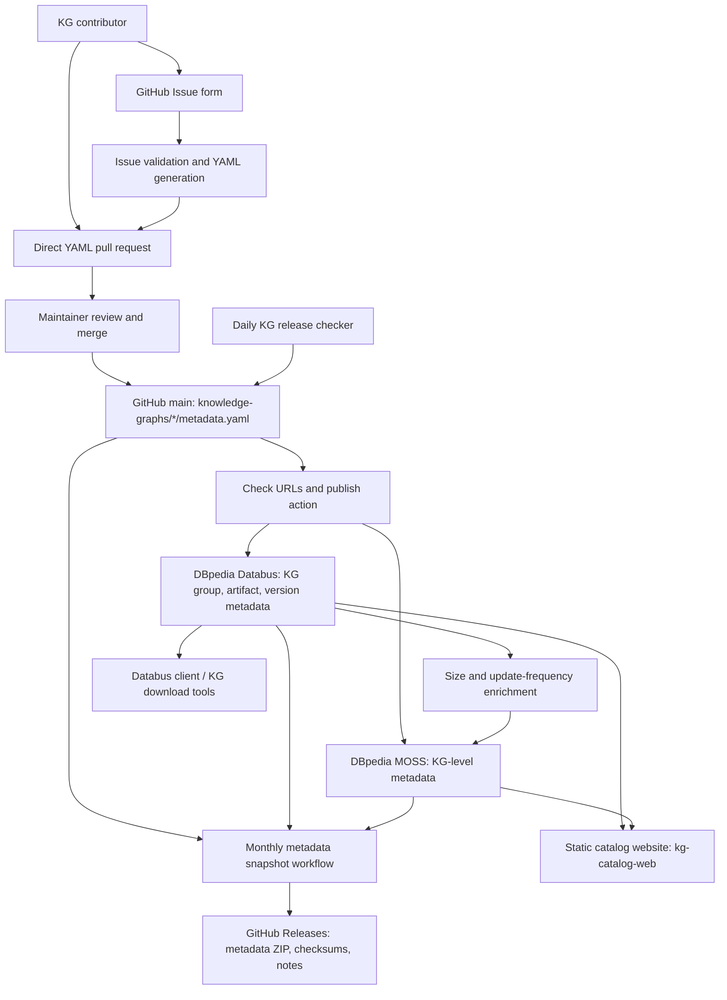

# System architecture

## Purpose and principles

The DBpedia Knowledge Graph Catalog is a community-maintained registry of knowledge graph **metadata**. It supports discovery, comparison, and access to distributed RDF datasets without requiring a dedicated catalog application server.

Design choices:

- **GitHub YAML is the editable source of truth** for submitted KG descriptions.
- **GitHub Issues and pull requests** provide an open contribution and review process.
- **GitHub Actions** perform validation, periodic checks, publication, enrichment, and release generation.
- **DBpedia Databus and MOSS** expose different published views of the metadata.
- **A GitHub Pages-hosted static web frontend**, sourced from the separate `dbpedia/kg-catalog-web` repository, makes catalog data browsable.

The metadata processing system does not store or mirror every underlying knowledge graph dataset. Distribution records link to files published by their providers; Databus provides metadata and access tooling around those distributions.

## Component and data-flow diagram



The diagram represents logical relationships, not a single atomic pipeline: scheduled tasks and external services operate independently.

## Repositories and external systems

| Component | Responsibility | Location |
| --- | --- | --- |
| `kg-catalog` | Source metadata, submission processing, publication scripts, automation, monthly snapshots | [GitHub](https://github.com/dbpedia/kg-catalog) |
| `kg-catalog-web` | Static website, KG browsing/profiles, submission/download guidance | [GitHub](https://github.com/dbpedia/kg-catalog-web) |
| GitHub Issues | Guided metadata submissions | [New KG form](https://github.com/dbpedia/kg-catalog/issues/new?template=new-kg-submission.yml) |
| GitHub Actions | Scheduled and event-driven tasks | [Workflows](https://github.com/dbpedia/kg-catalog/actions) |
| DBpedia Databus | Published group, artifact, version, and distribution metadata | [Catalog account](https://databus.dbpedia.org/knowledge-graph-catalog) |
| DBpedia MOSS | Complementary KG-level metadata, such as domains, keywords, maintainers, and derived metrics | MOSS service (currently configured against `moss.dev.dbpedia.link`) |
| GitHub Releases | Timestamped catalog metadata snapshots and analysis files | [Release list](https://github.com/dbpedia/kg-catalog/releases) |
| KG publishers | Original distribution files linked from metadata | External dataset URLs in YAML |

## Data ownership and meaning

### 1. Source metadata (GitHub)

Files at `knowledge-graphs/<kg-id>/metadata.yaml` capture descriptions entered by contributors and maintainers: KG identity, license, domain, optional endpoint/maintainers, and a hierarchy of artifacts, versions, and distribution URLs. Certain automated scripts can also modify these files, including status changes, release discoveries, and publication flags.

### 2. Published release metadata (Databus)

`scripts/publish_to_databus_http.py` turns selected YAML descriptions into Databus Group, Artifact, and Version resources, with distribution descriptions. Databus publication is controlled by `databus-publish` in each source YAML. The Databus group URI normally has the form:

```text
https://databus.dbpedia.org/knowledge-graph-catalog/<kg-id>
```

### 3. Published KG-level metadata (MOSS)

`scripts/publish_to_moss_http.py` builds RDF/Turtle describing complementary fields such as homepage, domain, keywords, SPARQL endpoint, and maintainers. MOSS publication is controlled by `moss-publish`. Additional scripts update size and recent update-frequency values in MOSS from Databus metadata.

### 4. Web presentation

The static frontend is stored in [dbpedia/kg-catalog-web](https://github.com/dbpedia/kg-catalog-web), not in this repository. Its JavaScript code accesses published catalog information, including Databus and MOSS. This avoids deploying an application backend for catalog browsing, but also makes service availability and browser/API integration operational dependencies.

### 5. Monthly metadata releases

The monthly workflow exports the current GitHub YAML, live Databus descriptions, and live MOSS descriptions into one **metadata-only** archive. It includes provenance, a summary, and a change report. These snapshots reflect multiple systems gathered sequentially and are **not a transactionally consistent point-in-time database backup**. See [Releases](releases.md).

## Main lifecycle

1. A contributor submits an issue or a direct pull request.
2. Issue submissions receive automatic form validation and a generated pull request if valid. Direct YAML pull requests currently require human/manual checks because no dedicated PR validation workflow exists.
3. A maintainer merges approved changes into `main`.
4. A push affecting KG YAML triggers URL checks followed by Databus and MOSS publication as indicated by flags. The workflow can modify and commit YAML statuses/flags.
5. A daily check looks for new versions of selected KGs by executing KG-specific scripts; these updates can start the same publication flow.
6. Periodic enrichment updates metrics in MOSS, and the monthly release workflow archives the published state.

## Reliability boundaries

- **Review is essential:** Not every source YAML has the same completeness, and direct pull requests do not yet have a PR-triggered schema check.
- **Publication is not atomic:** Changes may reach Databus before MOSS; a later step failure can leave the external systems temporarily inconsistent.
- **Network checks are limited:** The current URL checker skips distributions already marked `active`; it is not continuous monitoring of all active downloads.
- **Metadata sources can disagree:** Monthly release generation explicitly checks coverage and can fail when GitHub, Databus, and MOSS have diverged.
- **MOSS environment needs a decision:** Several scripts are currently configured against `moss.dev.dbpedia.link`; verify whether this is the intended long-term endpoint before treating it as production.

For implementation details, see [Automation](automation.md), [Operations](operations.md), and the `.github/workflows` directory.
